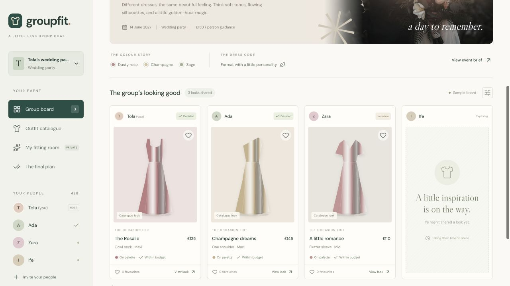
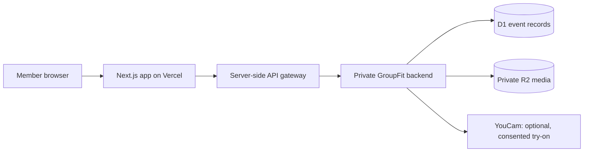

# GroupFit

### Get dressed together, even when you’re apart.

GroupFit is a responsive outfit-planning app for small groups preparing for a shared occasion. It brings the event brief, outfit ideas, private previews, feedback, and final decisions into one place.

Built around wedding parties and coordinated guests, with room for celebrations, photoshoots, and other formal events.

**[Open the app](https://groupfit-ten.vercel.app/)** · **[Source code](https://github.com/ChisomAniefuna/Group-fit)** · **[Mobile preview](docs/images/groupfit-mobile.png)**

> **Project status:** Hackathon MVP. The Vercel interface is deployed with private access. The production backend connection is pending configuration approval, and live YouCam generation is not configured. You can explore the clearly labelled sample event without either connection. Catalogue garments and prices are illustrative demo data.



## The problem

Coordinating outfits usually means scattered shopping links, screenshots, budget conversations, and long message threads. An organizer needs a coherent group look, while each member needs space for their own style, comfort, and spending preferences.

GroupFit helps the group move from separate ideas to an agreed shortlist. Its main value is coordination: individual choice, a shared direction, and a clear decision.

## What’s included

- **Event briefs:** Occasion, date, colour palette, per-person budget guidance, and organizer notes.
- **Private invitations:** Invite codes, rotating or revocable links, and rooms for up to eight members when the backend is connected.
- **Curated catalogue:** Ten original garment illustrations, sample GBP prices, and search, colour, fabric, and budget filters.
- **Private fitting room:** Save a catalogue draft; optional YouCam integration can generate a private preview after consent and provider setup.
- **Shared event board:** Publish approved looks, withdraw them, and compare the group’s choices.
- **Favourites and feedback:** Toggle favourites and add structured thoughts such as “Colour works” or “Needs discussion.”
- **Group decisions:** Members confirm their own choices; the organizer reviews blockers, agrees the plan, or reopens it.
- **Summary download:** Export a text coordination plan containing shared outfit choices.
- **Responsive interface:** Phone, tablet, and desktop layouts, larger mobile controls, keyboard navigation, and reduced-motion support.

## How it works

1. **Create an occasion.** Set a brief, palette, date, and budget guidance.
2. **Invite your people.** Share a private invitation with the group.
3. **Find a look.** Browse the catalogue and save a private draft.
4. **Preview if you choose.** With YouCam configured, upload permitted images and consent to generation.
5. **Share on your terms.** Publish the look you approve; your original image and private budget stay out of the group board.
6. **Decide together.** Review favourites and feedback, confirm individual choices, and agree the group plan.

The initial sample room uses fictional participants and illustrative looks. It is an interactive demo, not a live group session. Demo changes reset when the page reloads.

## Voice feature: recommended next step

**Planned — not implemented yet.**

Short voice notes attached to shared looks are the recommended first voice feature. They let members explain a preference or ask a question without arranging a live call or typing a long message.

Proposed experience:

- Tap **Record a voice note** on a shared look and grant microphone permission.
- Record up to 30 seconds, then preview, re-record, or discard the clip.
- Explicitly choose **Share voice note** to make it available to authorized event members.
- Play, pause, or remove the note; retain a text feedback option for people who cannot hear or record audio.
- Store clips privately, check membership on playback, and define expiry and deletion behaviour before launch.

Recording can use the browser’s [`MediaRecorder` API](https://developer.mozilla.org/en-US/docs/Web/API/MediaRecorder) without an AI API key. Secure storage and group delivery still require the authenticated backend connection. Automatic transcription, if added later, needs a separate implementation and privacy review.

Voice commands and read-aloud can follow as accessibility improvements. Live group voice chat is outside the current MVP scope.

## Run locally

Use **Node.js 22.13 or later** and npm.

```bash
git clone https://github.com/ChisomAniefuna/Group-fit.git
cd Group-fit
npm ci
npm run dev
```

Open [http://localhost:3000](http://localhost:3000).

The sample event works without a private API key. Persistent event operations need the existing backend connection; this repository does not contain a standalone database or storage deployment.

```bash
npm run check  # TypeScript
npm run build  # Production build using webpack
npm start      # Serve the production build
```

## Architecture

| Layer | Technology / responsibility |
| --- | --- |
| Interface | Next.js App Router, React, TypeScript, Tailwind CSS, Lucide icons |
| Hosting | Vercel; GitHub `main` is the production branch |
| API gateway | Server-only Next.js routes forwarding explicit GroupFit operations |
| Existing backend | Cloudflare-backed service for events, guest sessions, votes, and private media |
| Persistence | D1 for application records; R2 for generated preview files |
| Optional try-on | YouCam AI Clothes V4, called by the backend after provider configuration |



The gateway accepts only the room, media, and try-on routes. It does not expose the backend service credential to the browser or allow arbitrary upstream URLs.

## Configuration and deployment status

This README contains **no private keys, access tokens, or secret values**. The configuration name below is only a placeholder name.

| Setting | Location | Purpose |
| --- | --- | --- |
| `GROUPFIT_BACKEND_TOKEN` | Protected, server-only Vercel environment variable | Authorizes the gateway to reach the existing private backend |
| YouCam provider configuration | Existing backend only | Enables live garment preview generation |

The backend credential has **not been configured in Vercel by this project’s setup flow**; transferring it requires the owner’s explicit approval. No real credential belongs in source control, this README, an issue, a screenshot, or any `NEXT_PUBLIC_` variable.

A blank configuration example is available in [`.env.example`](.env.example). Local environment files and Vercel metadata are ignored by Git.

The repository is connected to the existing Vercel project. Pushes to `main` trigger deployment. Private Vercel access is enabled, so visitors may need Vercel sign-in and project access before using an event invitation.

The existing backend retains event data. Browser guest cookies are scoped to a hostname; moving to the Vercel URL does not transfer a guest session from the old address.

## Privacy and decision rules

- A draft stays private until its owner shares it. Withdrawal blocks other members’ access.
- Original try-on photos are forwarded to YouCam only after consent and are not saved by GroupFit’s backend. Provider retention follows YouCam’s policies.
- Private budget amounts are excluded from other members’ event responses; the board can show budget status.
- Generated preview access expires after seven days. Replacement or explicit deletion removes the stored preview; physical expiry of older objects requires a storage cleanup policy.
- A member can favourite each current shared member-look once, and can remove the favourite. Multiple members’ looks can be favourited.
- Replacing or withdrawing a look clears its votes. Votes do not automatically finalize a decision.
- Finalization requires at least three members, confirmed shared choices, satisfied palette and budget constraints, and resolved feedback.
- AI previews are styling approximations, not guarantees of size, fit, fabric drape, or retailer availability.

## Validation and current limits

The existing app has passed production builds, TypeScript checks, and a scripted three-session collaboration test covering invitations, draft and budget privacy, sharing, voting, finalization, host permissions, and cross-event access checks. Layouts were checked at widths from 320px to 1440px. These are development checks, not a claim of a complete security or accessibility audit.

Remaining work:

- Connect and verify the production backend on Vercel.
- Configure YouCam and validate authentic results using permitted images.
- Replace demo catalogue data with licensed garment photography and verified retailer information.
- Add the proposed private voice-note workflow, playback accessibility, and retention controls.
- Validate the experience with real organizers and members across devices.

On the Vercel version, personal-photo input is limited to 2 MB and the two try-on images must stay under 4 MB combined. Payments, fulfilment, live voice calls, public social feeds, and composite group-image generation are outside the current scope.

## Contributing

Open an issue describing the problem and expected behaviour, or submit a focused pull request. Run `npm run check` and `npm run build` for code changes. Use fictional demo data in screenshots and reports, and never include personal photos, invitation codes, or credentials.
