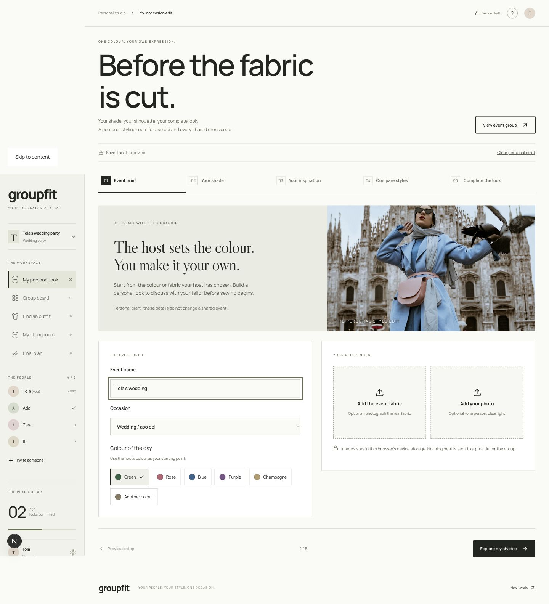
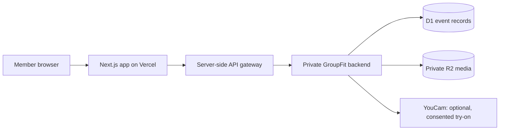

# GroupFit

### Your shade. Your style. Your occasion.

GroupFit is a personal styling room for event dress codes, starting with Nigerian aso ebi occasions. The host sets the colour or fabric; each guest explores their own shade, silhouette and finishing details before taking a clear brief to their tailor.

**[Open the public app](https://groupfit-ten.vercel.app/)** · **[Source code](https://github.com/ChisomAniefuna/Group-fit)** · **[Mobile preview](docs/images/groupfit-studio-mobile.png)**

> **Project status:** Hackathon MVP. The Vercel production app is public. The personal styling journey works locally without an API key. Skin-tone analysis, personalized shade ranking, recolouring, clothes try-on, and makeup/accessory VTO are **not connected**. The interface explicitly distinguishes manual choices and original references from generated results. Live group events also require the backend connection; the sample group is fictional.



## The problem

At an aso ebi celebration, guests may share one fabric or colour while choosing individual styles. Shade, gele, shoes, silhouette and makeup decisions happen across saved screenshots and messages. Once the tailor cuts the fabric, changing direction is expensive.

GroupFit gathers these decisions into one personal brief. The original group wardrobe remains a secondary space for coordinating with friends.

## What works today

- **Event brief:** Enter an occasion and colour family or custom colour, with optional fabric and personal photos.
- **Manual shade exploration:** Compare four shades. Undertone is an optional self-reported note, not photo analysis. Pairing ideas are general starting points, not skin-personalized recommendations.
- **Several images per style:** Keep up to four styles, with four references each. Mark a full-body reference and retain close-ups and tailoring notes.
- **Reference comparison:** Compare saved inspiration and select a style. No original image is presented as a try-on result.
- **Finishing preferences:** Select a lip direction and jewellery finish for the brief.
- **Tailor card:** Download self-contained printable HTML containing the selected style’s image copies, fabric reference, shade, pairing ideas and notes. Open it and use Print to save as PDF. The selfie is excluded.
- **Device drafts:** Images are resized locally and stored in IndexedDB on the current browser/device. The personal studio sends no photos to a provider or group. Clear the personal draft from the studio when finished.
- **Secondary group workflow:** Explore ten original garment illustrations, privately save an outfit, explicitly review sharing, and confirm a group plan. Finalization lists outstanding constraints. Demo group changes reset on reload; personal drafts persist.
- **Responsive design:** Phone, tablet and desktop layouts, keyboard focus, labelled controls and reduced-motion support. Decorative sparkle/star branding has been removed.

## The guest journey

1. Enter the host’s colour or add a fabric photo.
2. Explore shades manually and note an undertone if already known.
3. Add permitted full-body inspiration and detail photos for each style.
4. Compare references and choose the style to brief.
5. Choose finishing preferences, add notes and download the tailor card.

Uploads are JPG, PNG or WebP, up to 8 MB each. Copies are resized to a maximum 1,600-pixel edge. Upload screenshots directly; there is no Instagram connection. Use images you own or have permission to use. Device drafts do not sync between browsers. Screen colours are approximate; confirm the physical fabric and construction with the tailor.

## YouCam integration roadmap

The intended demo uses Skin Tone Analysis for measured undertone/depth, Clothes Try-On for reference styles on the guest, and Makeup VTO for finishing previews. Those services require server-side setup and real results before the app can claim personalized rankings or generated previews. Recolouring also needs implementation and validation. No private API key is included in this repository or needed for the current manual studio.

Perfect Corp documents both model-worn and clean garment references for [Clothes Try-On V4](https://www.perfectcorp.com/business/blog/ai-clothes/ai-clothes-try-on-api-v4-outerwear). A front-facing full-body reference is the intended input; close-ups are additional tailor references. Quality on real aso ebi construction remains to be tested with permitted photos and a configured provider. See the official [clothes reference](https://docs.perfectcorp.com/reference/ai_clothes/section/overview) and [makeup reference](https://docs.perfectcorp.com/reference/makeup_vto/section/overview).

## Voice feature: recommended next step

**Planned — not implemented yet.**

Short voice notes attached to shared looks are the recommended first voice feature. They let members explain a preference or ask a question without arranging a live call or typing a long message.

Proposed experience:

- Tap **Record a voice note** on a shared look and grant microphone permission.
- Record up to 30 seconds, then preview, re-record, or discard the clip.
- Explicitly choose **Share voice note** to make it available to authorized event members.
- Play, pause, or remove the note; retain a text feedback option for people who cannot hear or record audio.
- Store clips privately, check membership on playback, and define expiry and deletion behaviour before launch.

Recording can use the browser’s [`MediaRecorder` API](https://developer.mozilla.org/en-US/docs/Web/API/MediaRecorder) without an AI API key. Secure storage and group delivery still require the authenticated backend connection. Automatic transcription, if added later, needs a separate implementation and privacy review.

Voice commands and read-aloud can follow as accessibility improvements. Live group voice chat is outside the current MVP scope.

## Run locally

Use **Node.js 22.13 or later** and npm.

```bash
git clone https://github.com/ChisomAniefuna/Group-fit.git
cd Group-fit
npm ci
npm run dev
```

Open [http://localhost:3000](http://localhost:3000).

The sample event works without a private API key. Persistent event operations need the existing backend connection; this repository does not contain a standalone database or storage deployment.

```bash
npm run check  # TypeScript
npm run check
npm test
npm run build  # Production build using webpack
npm start      # Serve the production build
```

## Architecture

| Layer | Technology / responsibility |
| --- | --- |
| Interface | Next.js App Router, React, TypeScript, Tailwind CSS, Lucide icons |
| Hosting | Vercel; GitHub `main` is the production branch |
| API gateway | Server-only Next.js routes forwarding explicit GroupFit operations |
| Existing backend | Cloudflare-backed service for events, guest sessions, votes, and private media |
| Personal persistence | Browser IndexedDB for personal draft and resized reference copies |
| Group persistence | D1 for application records; R2 for generated preview files, once connected |
| Optional try-on | YouCam AI Clothes V4, called by the backend after provider configuration |



The personal studio stays in the browser; the following gateway supports the secondary group workflow. The gateway accepts only the room, media, and try-on routes. It does not expose the backend service credential to the browser or allow arbitrary upstream URLs.

## Configuration and deployment status

This README contains **no private keys, access tokens, or secret values**. The configuration name below is only a placeholder name.

| Setting | Location | Purpose |
| --- | --- | --- |
| `GROUPFIT_BACKEND_TOKEN` | Protected, server-only Vercel environment variable | Authorizes the gateway to reach the existing private backend |
| YouCam provider configuration | Existing backend only | Enables live garment preview generation |

The backend credential has **not been configured in Vercel by this project’s setup flow**; transferring it requires the owner’s explicit approval. No real credential belongs in source control, this README, an issue, a screenshot, or any `NEXT_PUBLIC_` variable.

A blank configuration example is available in [`.env.example`](.env.example). Local environment files and Vercel metadata are ignored by Git.

The repository is connected to the existing Vercel project. Pushes to `main` trigger deployment. The production URL is public and does not require Vercel sign-in. Preview deployments remain protected.

The existing backend retains event data. Browser guest cookies are scoped to a hostname; moving to the Vercel URL does not transfer a guest session from the old address.

## Privacy and decision rules

- A draft stays private until its owner shares it. Withdrawal blocks other members’ access.
- Original try-on photos are forwarded to YouCam only after consent and are not saved by GroupFit’s backend. Provider retention follows YouCam’s policies.
- Private budget amounts are excluded from other members’ event responses; the board can show budget status.
- Generated preview access expires after seven days. Replacement or explicit deletion removes the stored preview; physical expiry of older objects requires a storage cleanup policy.
- A member can favourite each current shared member-look once, and can remove the favourite. Multiple members’ looks can be favourited.
- Replacing or withdrawing a look clears its votes. Votes do not automatically finalize a decision.
- Finalization requires at least three members, confirmed shared choices, satisfied palette and budget constraints, and resolved feedback.
- AI previews are styling approximations, not guarantees of size, fit, fabric drape, or retailer availability.

## Validation and current limits

The personal studio passed upload, export, reload persistence and responsive browser checks, plus tests for safe card output and selfie exclusion. The existing group app has passed production builds, TypeScript checks, and a scripted three-session collaboration test covering invitations, draft and budget privacy, sharing, voting, finalization, host permissions, and cross-event access checks. Layouts were checked at widths from 320px to 1440px. These are development checks, not a claim of a complete security or accessibility audit.

Remaining work:

- Connect and verify the production backend on Vercel.
- Configure YouCam and validate authentic results using permitted images.
- Replace demo catalogue data with licensed garment photography and verified retailer information.
- Add the proposed private voice-note workflow, playback accessibility, and retention controls.
- Validate the experience with real organizers and members across devices.

In the secondary group fitting room, try-on photo input is limited to 2 MB each and 4 MB combined. The personal studio accepts up to 8 MB per image and resizes it locally. Payments, fulfilment, live voice calls, public social feeds, and composite group-image generation are outside the current scope.

## Contributing

Open an issue describing the problem and expected behaviour, or submit a focused pull request. Run `npm run check` and `npm run build` for code changes. Use fictional demo data in screenshots and reports, and never include personal photos, invitation codes, or credentials.
